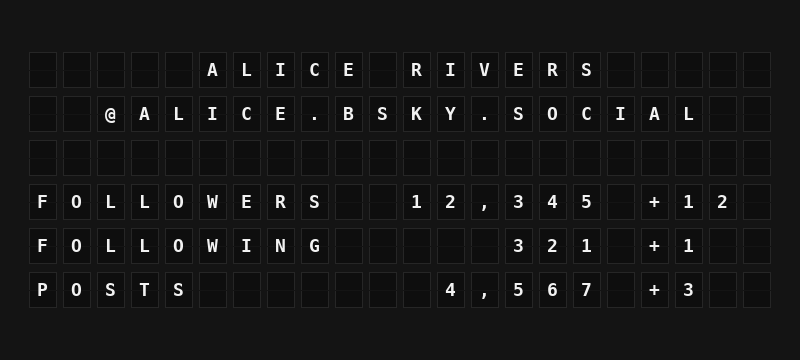

# Bluesky Stats Plugin

Show any Bluesky account's followers, following and post counts on your board, with how much each changed today.



**→ [Setup Guide](./docs/SETUP.md)**

## Overview

The Bluesky Stats plugin reads a public Bluesky profile through the Bluesky AppView (`app.bsky.actor.getProfile` on `public.api.bsky.app`) and turns it into board-ready variables: the display name, handle, and follower, following and post counts in full (`12,345`) and short (`12.3K`) form. There is no sign-in and no API key; just enter a handle.

It also shows the change since the first reading of the day (for example `+12`). That baseline lives in memory: it starts over at local midnight, when you change the handle, and when FiestaBoard restarts.

## Template Variables

### Profile

| Variable | Description | Example |
|----------|-------------|---------|
| `{{bluesky_stats.display_name}}` | Display name (the handle when none is set) | `ALICE RIVERS` |
| `{{bluesky_stats.handle}}` | Handle without the @ | `ALICE.BSKY.SOCIAL` |

### Counts

| Variable | Description | Example |
|----------|-------------|---------|
| `{{bluesky_stats.followers}}` | Followers, with thousands separators | `12,345` |
| `{{bluesky_stats.followers_short}}` | Followers, abbreviated | `12.3K` |
| `{{bluesky_stats.following}}` | Accounts followed | `321` |
| `{{bluesky_stats.following_short}}` | Accounts followed, abbreviated | `321` |
| `{{bluesky_stats.posts}}` | Posts | `4,567` |
| `{{bluesky_stats.posts_short}}` | Posts, abbreviated | `4.6K` |
| `{{bluesky_stats.followers_count}}` | Followers as a plain number (for color rules) | `12345` |
| `{{bluesky_stats.following_count}}` | Following as a plain number | `321` |
| `{{bluesky_stats.posts_count}}` | Posts as a plain number | `4567` |

### Today's Change

| Variable | Description | Example |
|----------|-------------|---------|
| `{{bluesky_stats.followers_change}}` | Change in followers since the day's first reading | `+12` |
| `{{bluesky_stats.following_change}}` | Change in following | `+1` |
| `{{bluesky_stats.posts_change}}` | Change in posts | `+3` |

The change variables are empty when **Show Today's Change** is off.

## Example Templates

Full board:

```
{{bluesky_stats.display_name}}
@{{bluesky_stats.handle}}

FOLLOWERS {{bluesky_stats.followers}} {{bluesky_stats.followers_change}}
FOLLOWING {{bluesky_stats.following}} {{bluesky_stats.following_change}}
POSTS {{bluesky_stats.posts}} {{bluesky_stats.posts_change}}
```

Note:

```
{{bluesky_stats.display_name}}
{{bluesky_stats.followers_short}} FANS {{bluesky_stats.followers_change}}
{{bluesky_stats.posts_short}} POSTS
```

## Configuration

| Setting | Key | Default | Description |
|---------|-----|---------|-------------|
| Enable Bluesky Stats | `enabled` | `false` | Turn the plugin on |
| Bluesky Handle | `handle` | (required) | Account to show: `alice.bsky.social`, `@alice`, `alice` (means `alice.bsky.social`), a custom domain, or a DID |
| Show Today's Change | `show_change` | `true` | Fill the `*_change` variables |
| Refresh Interval (seconds) | `refresh_seconds` | `900` | How often to fetch; at least 60 |

## Features

- No sign-in or API key: uses Bluesky's public AppView
- Follower, following and post counts in full and short form
- Change since the day's first reading, kept in memory
- Accepts handles with or without `@`, bare names, custom domains and DIDs
- Keeps showing the last good numbers through network errors, rate limits and Bluesky outages
- Strips emoji and characters the board cannot show from display names

## Author

FiestaBoard Team
